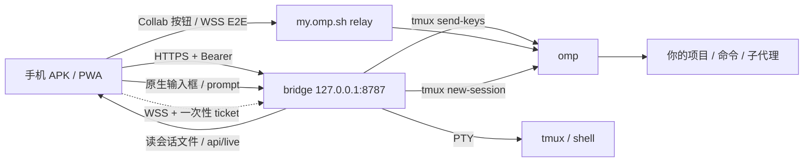

# omp mobile

[](https://github.com/helingfeng-hub/omp-mobile/releases)
[](LICENSE)
[](#你需要什么)

**把电脑里的 [omp](https://github.com/can1357/oh-my-pi) 搬到手机上。**

omp mobile 是 omp 的远程控制面板：电脑上跑一个 bridge，手机经 Tailscale 私有网络连进来，查看并继续电脑上的 omp 会话。打开 App 时如果还没有会话，会自动在默认目录启动一个；已有会话直接列出。默认聊天是 bridge 读取会话文件的实时视图，提示词从 bridge 注入 tmux；完整 Collab 房间通过按钮打开，不开放公网端口。

适合已经在电脑上用 omp 写代码、但人经常不在工位的人：地铁上补一句需求、夜里盯长任务、出门前审一眼 diff。

> 第一次听说 omp？omp 是终端里的 AI 编码 agent——读仓库、改文件、跑命令、开子代理、跑测试，自带 LSP/DAP 和计划模式。一条命令安装：
>
> ```bash
> curl -fsSL https://omp.sh/install | sh
> ```
>
> omp mobile 不替代它，也不自带模型。模型、凭据、代码始终留在你的电脑上；手机只是一块远程屏幕。

## 能做什么

| 功能 | 说明 |
| --- | --- |
| 自动会话 | 打开 App 时没有会话就自动在默认目录启动；已有会话直接列出，不用再点启动 |
| 实时对话 | 流式文本、thinking、工具卡片、子代理进度、模型与上下文状态 |
| 会话状态 | 当前会话顶部显示会话名、模型和上下文使用量 |
| 启动画面 | 冷启动短暂展示 omp mobile Logo，再进入会话列表 |
| 远程控制 | 原生输入框发提示词；打开 Collab 处理确认/选择弹窗 |
| 会话列表 | 显示主机名和会话标题；点任意会话；不是 bridge 托管、电脑上正在运行的会话先只读，停止后手机自动接管；已结束的会话直接恢复输入；手机创建的 tmux 会话右侧 ✕ 可停止并删除 |
| 工作站会话 | 工作站缓存的历史会话也在同一个列表；恢复使用会话记录的 cwd，不需要手机重新创建，host 重建后自动刷新链接 |
| 实时进度 | 运行中的会话显示只读实时进度；恢复后底部是原生输入框，多行自动增高，消息区独立滚动 |
| 连接提示 | 打开 Collab 房间时短暂显示连接提示；guest 加入提示 0.75 秒后隐藏 |
| 文本复制 | 长按对话文本使用系统选择菜单，可选择复制、全选复制 |
| 设置 | 主界面右上角齿轮；APK 打开原生连接设置，可点“返回主界面”回到原页面 |
| 自动标题 | 显示 omp 自动生成的会话标题，跟随电脑端的标题更新，不用手动重命名 |
| 完成通知 | Android 壳在后台轮询手机当前会话；回合结束（`busy=false`）后发系统通知，点通知回到会话 |
| 更新 | 每次启动检查版本，只有远端版本更高才弹窗；点“稍后”当天不再重复提示，下载由系统浏览器安装 |
| 两种壳 | Android APK 或 PWA（添加到主屏幕），同一套深色移动端 UI |
| 只读分享 | 生成 view-only 链接给朋友围观进度，不给执行权限 |

## 它不是什么

- **不是云服务**：没有服务器托管你的会话、代码或凭据；bridge 跑在你自己电脑上。
- **不是公网入口**：bridge 默认只监听 `127.0.0.1`，靠 Tailscale Serve 暴露给同一个 tailnet。不要用 Funnel，也不要做端口映射。
- **不是多租户平台**：一个 bridge 一个 token，适合个人或“每人各自部署一套”。不要拿它给互不信任的人共用。

## 你需要什么

| 项 | 要求 |
| --- | --- |
| 电脑 | Linux（已验证）或 Windows + WSL2；macOS 理论可用但未验证 |
| 常开 | 电脑休眠时手机连不上，Tailscale 也无法远程唤醒 |
| Node.js | 20 或更高（`node -v`） |
| omp | 已安装并完成模型登录（`omp --version`） |
| tmux | 用于托管会话，`tmux -V` |
| 模型账号 | 你自己的 provider API key 或 OAuth；费用由各自账号承担 |
| 网络 | 电脑和手机加入同一个 Tailscale tailnet，开启 HTTPS 证书 |
| 手机 | Android 8+；或支持 PWA 的浏览器（iOS 未验证） |

## 15 分钟上手

以 Linux 为例，Windows/WSL2 见[常见问题](#windows--wsl2)。

### 1. 电脑：安装并登录 omp

```bash
curl -fsSL https://omp.sh/install | sh
omp --version
omp login          # 选择 provider；也可以直接运行 omp 走首次引导
```

验证：终端里 `omp` 能正常对话。

**先完成这一步。** 否则手机上启动的会话会停在 omp 的登录/选模型界面。

### 2. 电脑：启动 bridge

```bash
mkdir -p ~/projects
git clone https://github.com/helingfeng-hub/omp-mobile.git
cd omp-mobile
npm install
OMP_REMOTE_ROOTS="$HOME/projects" npm start
```

- 首次启动会生成并打印一次 API token，之后从 `~/.config/omp-remote/token` 读取（权限 `0600`）。
- `OMP_REMOTE_ROOTS` 是手机新建会话的目录白名单，别设成 `/` 或整个 `$HOME`。
- 恢复工作站历史会话时使用会话文件记录的 cwd，不受这个白名单限制；新建会话仍受限制。
- 验证：电脑浏览器打开 `http://127.0.0.1:8787`，输入 token，能看到主机名和会话列表。

### 3. 电脑：发布到 tailnet

电脑和手机安装 [Tailscale](https://tailscale.com/download) 并登录同一账号；在 tailnet 管理页开启 MagicDNS 和 HTTPS 证书。

```bash
tailscale serve --bg 8787
tailscale serve status
```

手机访问 `https://<host>.<tailnet>.ts.net/`。

验证：手机浏览器能打开控制台登录页。

> 不要用 `tailscale funnel`。不要把 8787 映射到公网。ACL 只放行需要的设备。

### 4. 手机：安装壳

两种任选：

- **APK**：从 [Releases](https://github.com/helingfeng-hub/omp-mobile/releases) 下载 `omp-mobile-2.0.0.apk`，允许“未知来源”后安装。
- **PWA**：Chrome 打开 bridge 地址 → 菜单 → 添加到主屏幕。

首次打开填 bridge 地址（例如 `https://host.tailnet.ts.net/`）；进入后在右上角 ⚙ 填 API token。APK 里**长按页面**可重新设置地址。

### 5. 打开第一个会话

App 打开后会显示主机名和会话列表。没有会话时，bridge 会自动在 `OMP_REMOTE_ROOTS` 的第一个目录里启动一个 omp 会话；已经有会话时直接列出，不会重复启动。

点会话卡片进入 Collab。bridge 最多等 30 秒，直到 omp 发布 Collab host；失败时页面会给出“重试”入口。

验证：手机发一句“这个仓库是做什么的？”，同时在电脑上 `tmux attach -t omp-xxxx`，能看到同一个会话。

## 和朋友一起用

推荐**各自部署一套**：每人自己的电脑、自己的 omp 账号和模型费用、自己的 tailnet。代码相同，互不影响。

想互相看进度时，在自己电脑上执行：

```bash
omp collab list                          # 找 instanceId / pid
omp collab link <instanceId|pid> --view  # 只读链接
omp collab link <instanceId|pid>         # control 链接（等于执行权限）
```

也可以从 bridge 取：`GET /api/sessions/<name>/link?access=view`（需要 token）。

分享 **view** 链接就够了。**不要把带 token 的个人 APK 发给别人**——它内嵌了你的 bridge 地址和 API token。

## 架构



启动链路：

1. 手机 `POST /api/sessions {cwd}`。
2. bridge 在 tmux 里运行 `omp --config <overlay> --cwd <cwd>`；overlay 设置 `collab.autoStart: control`。
3. bridge 轮询 `omp collab list --json`，找到对应 host。
4. 手机默认 `GET /api/live?session=<name>` 拉实时消息；原生输入框 `POST /api/sessions/<name>/prompt {text}`，bridge 用 `tmux set-buffer`、`paste-buffer` 和 Enter 注入 host。
5. 需要完整 Collab 房间或审批时，手机 `GET /api/sessions/<name>/link?access=control|view`，在 iframe 打开该链接。
6. `/new`、`/resume` 会轮换 generation；链接过期时 bridge 自动重新获取。

从工作站历史会话继续时，链路是：

1. 手机点会话；bridge 判断该会话是否仍在电脑上运行。有 host，或会话文件仍被打开，或最后一条事件还不是 `session_exit`，手机进入只读实时视图，不启动 writer。
2. 电脑上的会话结束后，omp 写入 `session_exit`；手机检测到文件已结束且没有进程占用，自动 `POST /api/sessions {resume: "<sessionId>"}`。
3. bridge 读取该会话的 cwd，确认会话已结束且没有被占用，在 tmux 里运行 `omp --config <overlay> --cwd <cwd> --resume=<sessionId>`。
4. bridge 等到该 `sessionId` 对应的 host 出现；手机从只读视图自动切到原生输入框。

## 安全（务必读）

- **bridge 只监听 loopback**，外层用 Tailscale Serve；不要把 8787 暴露到公网。
- **API token 是第二道门**。它保存在手机 localStorage；共用设备或录屏时注意。
- **原生输入框等于电脑的远程执行权限。** 提示词经 bridge 直接注入 tmux，不是 Collab guest，能触发 host 的所有工具；远程使用时按下面的方式收紧 omp 审批。
- **Collab control 链接也等于远程执行权限。** 只围观就用 view 链接；手机打开 Collab 时按会话状态取 control 或 view。
- **远程使用时收紧 omp 审批**：

  ```bash
  omp config set tools.approvalMode write   # always-ask | always-ask-cached | write | yolo
  omp config get bash.patterns              # 可追加 deny 规则
  ```

  不要长期 `yolo`。
- **个人 APK 内嵌 token**，只在自己设备上安装。构建脚本的默认签名口令是公开的；自己发布 APK 前用 `OMP_ANDROID_KEYSTORE_PASS` 换掉，并备份 `~/.config/omp-mobile/android.keystore`（升级必须用同一把 key）。
- **`update.json` 无鉴权**（仅 tailnet 可达），不要往里放敏感信息。

## 常见问题

### 手机打不开 bridge 地址

1. `tailscale status` 看两端是否在线、是否同一 tailnet。
2. `tailscale serve status` 确认代理到 `127.0.0.1:8787`。
3. 确认 tailnet 已开启 HTTPS 证书；证书未就绪时 `*.ts.net` 会握手失败。
4. 在电脑上 `curl -I http://127.0.0.1:8787/healthz`，排除 bridge 自身问题。

### 返回 401

手机里的 token 和电脑不一致：

```bash
cat ~/.config/omp-remote/token
```

在 App 的 ⚙ 里重新粘贴；或网页端“清除 token”后重连。

### 自动启动失败 / 504

- 自动启动使用的是 `OMP_REMOTE_ROOTS` 的第一个目录；确认它存在且可写。
- 常见原因是 omp 未登录模型，或 `omp collab` 连不上 relay。
- 首次启动慢可以调大 `OMP_REMOTE_START_TIMEOUT_MS`，然后点页面上的“重试”。

### 聊天区域空白

聊天面板是 `my.omp.sh` 的 iframe。点右上角 ↗ 在浏览器打开；或在手机上确认能访问 `https://my.omp.sh`。企业网络/广告拦截器可能拦掉 WebSocket。

### 锁屏后不动了

手机挂起会断开 WebSocket，但电脑上的 tmux 会话和任务继续跑。重新打开页面即可补齐历史；当前没有推送通知。

### 电脑休眠 / 关机

无法远程冷启动，Tailscale 不能唤醒。需要常开、Wake-on-LAN 或智能插座。

### Windows / WSL2

omp 和 tmux 跑在 WSL2，bridge 跑在 Windows 原生 Node，通过 `wsl.exe` 操作；Tailscale 也装在 Windows 上，避免 WSL 网络转发。

```bat
set OMP_REMOTE_ADAPTER=wsl
set OMP_REMOTE_WSL_DISTRO=Ubuntu
set OMP_REMOTE_ROOTS=/home/youruser/projects
node src\index.js
```

用“登录时”的 Task Scheduler 任务运行，**不要**用 SYSTEM 账户（拿不到 WSL 用户和 omp 凭据）。`node-pty` 需要可用的 ConPTY；装不上时 bridge 仍可聊天。

### 想换端口 / 管多台电脑

改 `OMP_REMOTE_PORT` 并同步改 `tailscale serve` 的目标端口。APK 只记一个地址，长按页面可切换；多台电脑建议分别用 PWA 图标。

## 进阶

### 配置

| 变量 | 默认 | 说明 |
| --- | --- | --- |
| `OMP_REMOTE_HOST` | `127.0.0.1` | bridge 监听地址；保持 loopback |
| `OMP_REMOTE_PORT` | `8787` | 端口 |
| `OMP_REMOTE_TOKEN` | 自动生成 | API token；也可写入 `~/.config/omp-remote/token` |
| `OMP_REMOTE_STATE_DIR` | `~/.config/omp-remote` | token、overlay 配置 |
| `OMP_REMOTE_ROOTS` | `$HOME` | 手机新建会话的工作目录白名单；恢复历史会话使用记录的 cwd；逗号或分号分隔 |
| `OMP_REMOTE_ADAPTER` | 自动 | `linux` 或 `wsl` |
| `OMP_REMOTE_WSL_DISTRO` | 空 | WSL 发行版名，如 `Ubuntu` |
| `OMP_REMOTE_WSL` | `wsl.exe` | WSL 可执行文件 |
| `OMP_REMOTE_OMP` | `omp` | omp 路径/命令 |
| `OMP_REMOTE_TMUX` | `tmux` | tmux 路径 |
| `OMP_REMOTE_RELAY` | `wss://my.omp.sh` | Collab relay |
| `OMP_REMOTE_WEB` | 空 | Collab web UI；空则从 relay 推导 |
| `OMP_REMOTE_NAME` | 主机名 | 手机端显示名 |
| `OMP_REMOTE_TERMINAL` | `1` | `0` 关闭 Shell |
| `OMP_REMOTE_START_TIMEOUT_MS` | `30000` | 等待 Collab host 的超时 |
| `OMP_REMOTE_SESSION_DIR` | `~/.omp/agent/sessions` | 读取 omp 会话标题，用于手机端显示和活跃会话判断 |
| `OMP_PROFILE` | 空 | 传给 omp 的 profile；用于隔离会话/凭据 |

### 常驻运行（systemd user）

```bash
mkdir -p ~/.config/systemd/user
cp deploy/omp-mobile.service.example ~/.config/systemd/user/omp-mobile.service
# 按需修改路径/用户/环境变量；ExecStart 的 node 换成 `which node` 的输出
systemctl --user daemon-reload
systemctl --user enable --now omp-mobile
loginctl enable-linger "$USER"      # 注销后继续运行
```

### API

所有 `/api/*` 需要 `Authorization: Bearer <token>`。

| 方法 | 路径 | 作用 |
| --- | --- | --- |
| GET | `/api/health` | bridge/omp/tmux 状态 |
| GET | `/api/state` | 会话、host、roots、health |
| GET | `/api/live?session=` | 当前 omp 会话文件的最新消息、工具进度和上下文；ws 会话附带 `inUse`、`ended` |
| POST | `/api/sessions` | `{cwd}` 新建 tmux + omp；`{resume}` 恢复工作站会话；运行中返回 409 `session_in_use` |
| DELETE | `/api/sessions/:name` | 停止会话 |
| GET | `/api/sessions/:name/link?access=control\|view` | 取 Collab 链接 |
| POST | `/api/sessions/:name/prompt` | `{text}`，把提示词注入该 tmux 会话 |
| GET | `/api/sessions/:name/output?lines=100` | tmux 最近输出 |
| POST | `/api/terminal/ticket` | `{session?}` 或 `{cwd?}`，一次性终端 ticket |
| WS | `/ws/terminal?ticket=...` | PTY 输出（binary）和输入（JSON） |

`/healthz` 不需要 token，只返回 `{"ok":true}`，方便监控探活。

### 自己构建 APK

需要 Android SDK：build-tools（`aapt2`、`d8`、`zipalign`、`apksigner`）、platform `android.jar`、JDK 的 `javac`/`keytool`。

通用包（首次启动手填地址和 token）：

```bash
ANDROID_HOME=/path/to/android-sdk \
VERSION="2.0.0" VERSION_NAME="2.0.0" VERSION_CODE=23 \
./scripts/build-android.sh
```

个人包（内嵌地址和 token，**不要提交或分享**）：

```bash
OMP_MOBILE_URL="https://host.tailnet.ts.net/" \
OMP_MOBILE_TOKEN="$(cat ~/.config/omp-remote/token)" \
VERSION="0.1.2-personal" VERSION_NAME="0.1.2" VERSION_CODE=4 \
OMP_MOBILE_UPDATE_NOTES="修复..." \
./scripts/build-android.sh
```

只有设置 `OMP_MOBILE_URL` 时才会生成 `public/update.json` 和 `public/omp-mobile-latest.apk`。App 发现新版本后不再自行下载安装，而是用浏览器打开 `update.json` 里的 APK 链接，由系统浏览器和安装器完成更新。公开 Release 的 APK 不依赖它们，更新方式见 Release 页。

签名 key 默认在 `~/.config/omp-mobile/android.keystore`。升级必须用同一把 key，否则要先卸载旧版。

### 开发与测试

```bash
npm test        # 单元 + API 测试（不需要真实 omp）
npm run smoke   # 真实 omp + tmux + 本地 relay；创建并清理临时 profile/session
```

`npm run smoke` 需要本机有 `omp`、`tmux`，会启动隔离的 `OMP_PROFILE=omp-mobile-smoke`，覆盖 start/list/link/stop 和 PTY。

### 目录

```text
src/            bridge（Node ESM）
public/         PWA 控制台 + xterm 资源
android/        Android WebView 壳
scripts/        本地 relay、smoke、Android 构建
test/           node:test
deploy/         systemd 示例
```

## 已知边界

- 电脑休眠/关机时无法远程冷启动。
- 不是由本 bridge 托管的电脑端会话，手机只读。bridge 用 host、会话文件句柄和最后事件 `session_exit` 判断；近期没有结束标记的会话按运行中处理，超过 7 天按已放弃处理。会话正常结束后手机自动恢复并取得输入。
- 手机接管后不要再在电脑上向同一会话输入，否则两个 omp 进程会同时写会话文件。
- 原生输入框通过 tmux 直接输入 host，能执行 `/model`、`/compact`、`!` 等 host-only 命令；Collab guest 仍不能。审批弹窗和完整房间用 Collab 按钮打开。
- `/new`、`/resume` 后 room generation 会轮换；Collab 视图里点“重新连接”即可让 bridge 取新链接。
- 没有内置推送；锁屏后 WebSocket 可能断开，重开页面恢复。
- APK 只保存一个 bridge 地址；多主机用 PWA 分别添加。
- macOS 未验证；iOS/PWA 未验证。

## License

[MIT](LICENSE) © 2026 helingfeng

感谢 [omp](https://github.com/can1357/oh-my-pi) 及其 Collab 协议、[Tailscale](https://tailscale.com)、[xterm.js](https://xtermjs.org)、[node-pty](https://github.com/microsoft/node-pty) 和 [ws](https://github.com/websockets/ws)。
